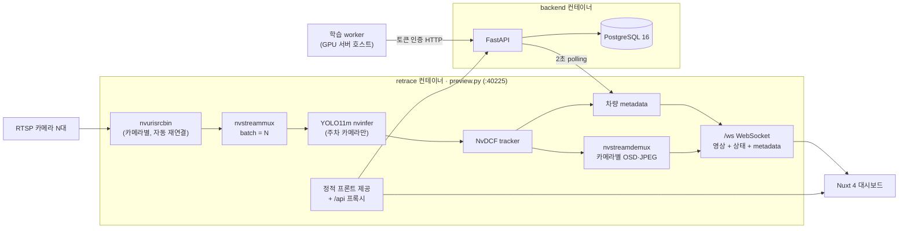

# ReTrace

**주차장 CCTV 영상을 GPU 하나에서 실시간으로 분석해 주차면별 점유 상태를 보여 주고, 같은 웹에서 데이터 수집·라벨링·모델 fine-tuning까지 이어지는 개인 프로젝트입니다.**

NVIDIA DeepStream으로 여러 대의 RTSP 카메라를 하나의 batch pipeline에서 처리하고, YOLO11m으로 차량을 검출·추적합니다.
FastAPI + PostgreSQL 백엔드가 주차면·데이터셋·학습 작업을 관리하며, Nuxt 4 대시보드에서 실시간 영상과 주차 현황을 확인합니다.

<br>

## 목차

- [주요 기능](#주요-기능)
- [시스템 구조](#시스템-구조)
- [기술 스택](#기술-스택)
- [기술적 고민과 해결](#기술적-고민과-해결)
- [프로젝트 구조](#프로젝트-구조)
- [실행 방법](#실행-방법)
- [테스트](#테스트)
- [현재 상태와 한계](#현재-상태와-한계)
- [상세 문서](#상세-문서)

<br>

## 주요 기능

### 1. 실시간 주차 현황

주차 카메라 영상 위에 주차 구역(폴리곤)을 겹쳐 그리고, 구역마다 **주차됨 / 빈자리 / 알 수 없음**을 실시간으로 표시합니다.
한 주차면을 여러 카메라가 함께 볼 수 있어서, 같은 라벨(`A-01`)을 고른 구역들은 하나의 물리적 자리로 묶입니다. 카메라마다 판정이 엇갈리면 `확인 필요`로 따로 보여 줍니다.

- 판정 방식 두 가지를 화면에서 바꿀 수 있습니다.
  - **차량 탐지**: 검출된 차량 박스의 하단(지면에 닿는 부분)이 구역과 얼마나 겹치는지로 판정합니다.
  - **색상**: 빈자리일 때 등록한 기준(HSV 히스토그램)과 현재 화면을 비교합니다. 딥러닝 모델 없이 동작합니다.
- 오른쪽 `주차면` 패널에서 라벨별 최종 상태와 카메라별 점수를 확인하고, 상태별로 필터링할 수 있습니다.
- **주차 구역 편집**: 영상 위를 클릭해 꼭짓점을 찍어 구역을 만들고, 라벨을 붙입니다. 꼭짓점 드래그·추가·삭제와 단축키(Enter, Esc, Backspace)를 지원합니다.
- **CCTV 모니터링**: 모든 카메라를 층별로 묶어 보여 줍니다. 화면에 보이는 카드만 영상을 구독하므로 카메라가 많아도 브라우저 부담이 커지지 않습니다.

### 2. AI 데이터셋 수집과 라벨링

운영 중인 카메라에서 바로 학습용 이미지를 모으고, 웹에서 차량 박스를 라벨링해 YOLO 형식 ZIP으로 내보냅니다.

- **이미지 수집**: 실시간 미리보기에는 검출 박스가 그려져 있지만, `현재 프레임 캡처`는 **박스가 그려지기 전 원본 프레임**을 저장합니다.
- **라벨링 목록**: 카메라·상태(대기 / 작업 중 / 검수 완료)로 필터링하고, 무한 스크롤로 넘겨 봅니다.
- **라벨링 에디터**: 드래그로 박스를 만들고 이동·크기 조절·삭제하며, 100~300% 확대를 지원합니다.
- **자동 라벨링**: 등록된 모델(기본 YOLO11m 또는 fine-tuning한 모델)이 라벨 없는 이미지에 초안 박스를 만들어 줍니다. 초안은 점선과 신뢰도(`AI 74%`)로 구분되고, 사람이 손댄 박스는 `manual`로 바뀌어 사람의 라벨을 덮어쓰지 않습니다.
- 내보내기는 촬영 세션 단위로 Train / Val / Test를 나눠서, 거의 같은 장면이 학습과 평가에 동시에 들어가는 것을 줄입니다.

### 3. 웹에서 모델 fine-tuning

- 검수한 데이터셋을 골라 GPU 서버에서 YOLO11m fine-tuning을 시작·감시·중지합니다. 학습 손실과 정밀도·재현율·mAP 곡선을 실시간으로 보여 줍니다.
- 학습은 브라우저나 API 요청 안에서 돌지 않고, GPU 서버 호스트의 별도 worker 프로세스가 맡습니다.
- 학습 중에도 운영 영상 처리가 우선입니다. 학습 전 VRAM을 추정하고, 학습 중 운영 카메라 FPS가 기준보다 떨어지면 학습을 안전하게 멈춥니다.
- 결과 모델은 같은 Test 세트에서 기존 모델과 비교하고, 학습에 쓰지 않은 새 이미지로 따로 평가할 수 있습니다. 운영 모델은 자동으로 바뀌지 않습니다.

### 4. 카메라 상태 관리

- 카메라마다 `connecting → online → degraded → offline → reconnecting` 상태를 프레임 수신 기준으로 판단합니다.
- 한 카메라가 끊겨도 나머지 카메라와 공유 추론 pipeline은 계속 동작하고, 끊긴 카메라는 자동으로 다시 연결합니다.

<br>

## 시스템 구조



- **retrace**(`preview.py`): DeepStream pipeline, 카메라 상태 관리, 영상 전송(WebSocket / MJPEG), 빌드된 프론트엔드 제공과 `/api` 프록시를 한 포트에서 맡습니다.
- **backend**(`backend/app`): GPU 없이 동작하는 FastAPI 서비스입니다. 카메라 상태·차량 metadata를 polling해 저장하고, 주차면·데이터셋·학습 작업 API를 제공합니다.
- **frontend**(`frontend/`): Nuxt 4 CSR 앱입니다. 로컬 PC에서 정적 파일로 빌드해 서버에 올리므로 서버에 Node.js가 필요 없습니다.
- **training worker**(`training/worker.py`): GPU 서버 호스트에서 Ultralytics로 학습·평가·자동 라벨링을 실행합니다.

<br>

## 기술 스택

| 영역 | 사용 기술 |
| --- | --- |
| 영상 처리 / 추론 | NVIDIA DeepStream 7.0, GStreamer, PyDS 1.1.11, TensorRT, YOLO11m(ONNX, DeepStream-Yolo parser), NvDCF tracker |
| Backend | Python, FastAPI, SQLAlchemy 2.0, psycopg 3, PostgreSQL 16, OpenCV(색상 판정) |
| Frontend | Nuxt 4(CSR), Vue 3 Composition API(`<script setup>`), TypeScript, Tailwind CSS 4, shadcn-vue(reka-ui), three.js |
| 학습 | Ultralytics YOLO11m, PyTorch 2.6(CUDA 12.4), Tesla V100 16GB |
| 인프라 | Docker Compose, NVIDIA Container Toolkit, Linux GPU 서버 |
| 테스트 | Python unittest / pytest, Node.js `node:test`, `vue-tsc` 타입 검사 |

<br>

## 기술적 고민과 해결

### 1. 카메라 여러 대를 GPU 하나에서 처리하기

카메라마다 pipeline과 추론 모델을 따로 띄우면 GPU 메모리와 TensorRT engine이 카메라 수만큼 늘어납니다.
그래서 모든 카메라를 **`nvstreammux` 하나로 batch 처리**하고, 차량 검출은 주차 카메라(`VEHICLE_CAMERA_IDS`)의 프레임에만 적용하도록 secondary `nvinfer`의 ROI로 한정했습니다.
주차와 상관없는 카메라는 추론 없이 영상만 전달하고, engine batch 크기는 주차 카메라 수에 맞춥니다.

TensorRT engine은 만드는 데 시간이 오래 걸려서 다시 쓸 수 있어야 합니다. `pgie_cache.py`는 모델 파일의 SHA-256, batch, precision, GPU 종류, TensorRT 버전 등으로 **build key**를 만들어, 조건이 같을 때만 engine을 재사용합니다. threshold나 NMS 같은 런타임 설정만 바꿀 때는 engine을 다시 만들지 않습니다.

### 2. 브라우저의 연결 6개 제한과 실시간 영상 전송

카메라별 MJPEG(``)는 응답을 계속 열어 두는데, 브라우저는 HTTP/1.1에서 같은 origin에 연결을 6개까지만 열기 때문에 한 화면에 카메라 7대 이상을 띄울 수 없습니다.
WebRTC도 시도했지만 Docker bridge 환경에서 ICE 연결이 진행되지 않았고, UDP·방화벽 등 운영 요소가 많아 제거했습니다.

최종적으로 **WebSocket 연결 하나(`/ws`)로 모든 카메라의 JPEG와 상태·metadata를 함께 전송**합니다.

- 영상은 `u8 version | u8 id 길이 | cameraId | u32 sequence | JPEG` 형식의 binary 메시지입니다.
- 프론트는 `IntersectionObserver`로 **화면에 보이는 카드만 구독**하고, JPEG를 한 장씩 decode하며 밀린 프레임은 버립니다.
- 서버는 카메라별 최신 프레임 한 장만 보관하고, token bucket으로 전송률을 제한해 느린 클라이언트가 pipeline을 막지 않게 했습니다.
- 측정에서 디코더가 프레임을 약 170 ms 붙잡고 있는 것을 확인해, 디코더 `low-latency-mode`를 켰습니다.

### 3. 장애가 다른 곳으로 번지지 않게 하기

- GStreamer 콜백(GPU 스레드)에서는 네트워크·DB I/O를 하지 않고 metadata를 복사만 합니다. 저장은 backend가 2초마다 polling해서 가져가므로, **backend가 죽어도 영상 처리는 계속**됩니다.
- 카메라 하나의 오류·EOS가 공유 pipeline을 멈추지 않도록, source별 오류는 공유 bus에서 해당 카메라로 라우팅하고 EOS는 mux에 전달하지 않습니다.
- 재연결할 때마다 **generation**을 올려, 끊기기 전 프레임의 track이나 박스가 새 연결의 데이터와 섞이지 않게 합니다.
- 로그와 오류에는 RTSP 주소나 GStreamer 원문 대신 `rtsp_timeout`, `source_eos` 같은 고정 코드만 남겨 비밀 값 노출을 막았습니다.

### 4. 주차 판정의 흔들림 줄이기

차량 박스 전체로 판정하면 비스듬한 카메라에서 옆 칸까지 주차된 것으로 보입니다. 그래서 박스의 **하단 25%를 지면 접촉 영역(footprint)** 으로 보고, 이 영역이 구역 폴리곤과 겹치는 비율로 판정합니다.

- 주차됨으로 바뀌는 기준(겹침 55%)과 빈자리로 돌아가는 기준(35%)을 다르게 둔 **hysteresis**와, 같은 결과가 연속 프레임(주차 2, 빈자리 3) 나와야 바뀌는 규칙으로 깜빡임을 줄였습니다.
- 신뢰도가 낮은 검출은 주차로 만들지 못하고, 빈자리로 바뀌는 것도 막습니다.
- 좌표는 원본 프레임 기준 0~1로 정규화해 저장하고, `videoGeometry.ts`가 letterbox와 화면 크기 변화를 반영해 영상 위 폴리곤 위치를 맞춥니다.

### 5. 학습이 운영을 방해하지 않게 하기

학습과 운영 추론이 **같은 GPU**를 씁니다. 그래서 학습은 웹 요청과 분리된 호스트 worker가 맡고, 여러 단계의 안전장치를 두었습니다.

- DB unique constraint(`active_slot`)로 학습 작업은 동시에 하나만 실행됩니다.
- 시작 전에 batch·이미지 크기로 VRAM을 추정해 여유가 부족하면 막고, 학습 중에는 운영 카메라 FPS 하락·Preview 무응답·GPU 여유 부족이 연속되면 학습을 멈춥니다.
- 사용자 입력으로 CLI 문자열을 만들지 않고, worker가 설정 값을 다시 검증해 인자 목록을 만듭니다. 학습 시작·중지에는 관리자 토큰이 필요합니다.
- 데이터셋 export는 작업 시작 시 SHA-256과 함께 고정 사본으로 남겨, 나중에 라벨을 고쳐도 실행 결과를 재현할 수 있습니다.

### 6. 영상을 끊지 않고 모델 교체하기 (진행 중)

fine-tuning한 모델을 운영에 반영할 때 컨테이너를 재시작하면 모든 카메라 영상이 끊깁니다.
`vehicle_deployment.py`는 DeepStream `nvinfer`의 **설정 파일을 실행 중에 교체(on-the-fly update)** 하고, 약 1분 동안 FPS와 추론 처리량을 교체 전과 비교해 기준에 못 미치면 **이전 모델로 자동 롤백**합니다.
실제 운영 환경 검증 과정에서 판정 기준을 여러 번 다듬었고, 현재도 운영 서버 검증을 이어 가고 있습니다.

<br>

## 프로젝트 구조

```text
ReTrace/
├─ preview.py              # DeepStream pipeline + HTTP/WebSocket 서버 (실행 진입점)
├─ camera_config.py        # 카메라 YAML 검증, 비공개 RTSP 주소 해석
├─ camera_runtime.py       # 카메라별 상태·재연결 세대 관리
├─ vehicle_detection.py    # 주차 카메라 차량 검출 설정
├─ vehicle_deployment.py   # 무중단 모델 교체·검증·롤백
├─ pgie_cache.py           # TensorRT engine 캐시 키·경로 관리
├─ preview_socket.py       # /ws: 다중 카메라 영상·상태 전송
├─ preview_web.py          # 정적 프론트 제공, /api 프록시
├─ preview_capture.py      # 데이터셋용 원본 프레임 캡처
├─ configs/                # 카메라 목록(공개 가능한 값만)
├─ backend/                # FastAPI + PostgreSQL (주차·데이터셋·학습 API)
├─ frontend/               # Nuxt 4 대시보드
├─ training/               # YOLO11m 학습·평가·자동 라벨링 (독립 venv, host worker)
├─ tools/                  # 진단·측정 스크립트
├─ tests/                  # Preview/pipeline CPU 테스트
├─ web/                    # 서버 내장 진단 페이지
└─ docs/                   # 기능별 설계 문서와 운영 가이드
```

<br>

## 실행 방법

GPU 서버(Linux, NVIDIA GPU, Docker Compose, NVIDIA Container Toolkit)가 필요합니다. 모델 파일, TensorRT engine, 실제 RTSP 주소(`.env`)는 저장소에 포함하지 않습니다.

```bash
# 1. 카메라 목록(configs/cameras.yaml)과 .env(RTSP 주소, VEHICLE_CAMERA_IDS 등)를 준비
# 2. 영상 처리 서비스와 백엔드 실행
docker compose build
docker compose up -d
docker compose ps
```

```bash
# 프론트엔드 개발 서버 (로컬 PC)
cd frontend
npm install
NUXT_PUBLIC_BACKEND_BASE_URL=http://<서버 주소>:40225 npm run dev
```

설치·모델 준비·카메라 진단·배포 절차는 [운영 가이드](docs/operations.md)에 자세히 정리했습니다.

<br>

## 테스트

GPU 없이 실행할 수 있는 CPU 테스트를 영역별로 두었습니다.

```bash
python3 -m unittest discover -s tests -p 'test_camera_*.py'   # 카메라 설정·상태·재연결 (fake GStreamer)
python3 -m unittest discover -s tests -p 'test_preview_realtime.py'  # 실제 loopback WebSocket 다중 카메라 전송
python -m pytest -q backend/tests                             # Backend API·polling·주차·데이터셋·학습
cd frontend && npm test && npm run typecheck                  # 프론트 로직 단위 테스트 + 타입 검사
```

`tests/test_preview.py`처럼 DeepStream(GI/PyDS)이 필요한 테스트는 GPU 서버 컨테이너에서 실행합니다.

환경 준비와 범위별 테스트 선택은 [testing 문서](docs/agent/testing.md)를 따릅니다.

<br>

## 현재 상태와 한계

- 2026-10-06에 시작해 계속 개발 중인 개인 프로젝트이며, 실제 건물의 카메라(주차 카메라 5대 포함)를 대상으로 GPU 서버에서 운영하고 있습니다.
- 앱 전체 사용자 인증은 아직 없고, 학습 제어만 관리자 토큰으로 보호합니다. 네트워크 노출 범위는 LAN/Tailscale 바인딩으로 제한합니다.
- 자동 라벨링과 무중단 모델 교체는 코드와 CPU 테스트는 끝났지만, 실제 GPU 서버에서의 검증은 진행 중입니다.
- 카메라 간 동일 차량/인물 매칭(Re-ID)은 구현하지 않았습니다. 초기의 사람 검출(PeopleNet)은 주차 기능에 집중하기 위해 제거했습니다.

<br>

## 상세 문서

| 문서 | 내용 |
| --- | --- |
| [운영 가이드](docs/operations.md) | 설치, Docker 실행, 모델 준비, 카메라 진단, GitHub 작업 흐름 |
| [실시간 Preview](docs/preview-realtime.md) | WebSocket binary 형식, 대역폭, WebRTC 제거 이유 |
| [차량 탐지와 주차 점유](docs/parking-occupancy.md) | 차량 모델, 좌표 체계, 점유 판정 규칙 |
| [색상 기반 주차](docs/color-parking.md) | HSV 기준선 판정, 저장 구조 |
| [AI 데이터셋](docs/datasets.md) | 캡처, 라벨링, 자동 라벨링, export 분할 |
| [웹 fine-tuning](docs/training.md) | 학습 worker, GPU 보호, 평가, 모델 배포 |
| [학습 환경](training/README.md) | 학습 스크립트, GPU 측정값, 클래스 전략 |
| [Backend](backend/README.md) | API, 데이터 흐름, 저장 정책 |
| [Frontend](frontend/README.md) | 화면 구조, 실시간 연결, 주차 편집 |
| [아키텍처 요약](docs/agent/architecture.md) | 모듈별 책임과 경계 |
